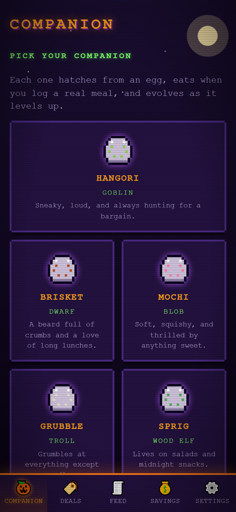
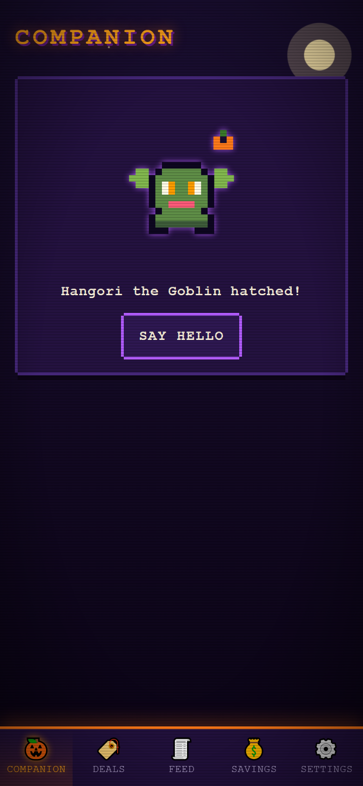
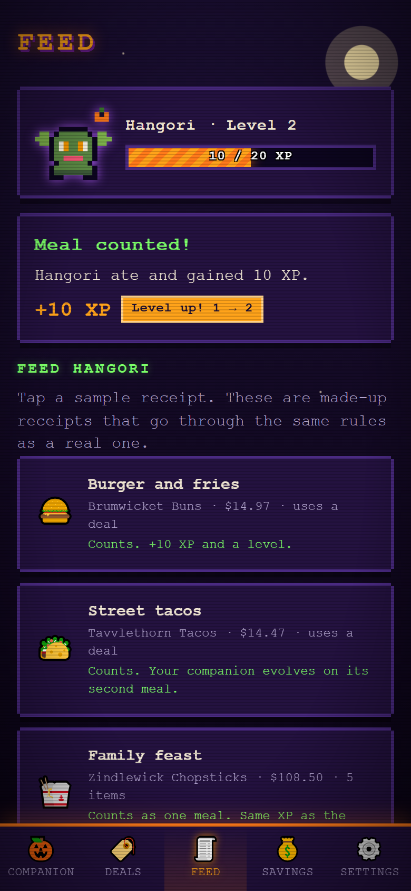
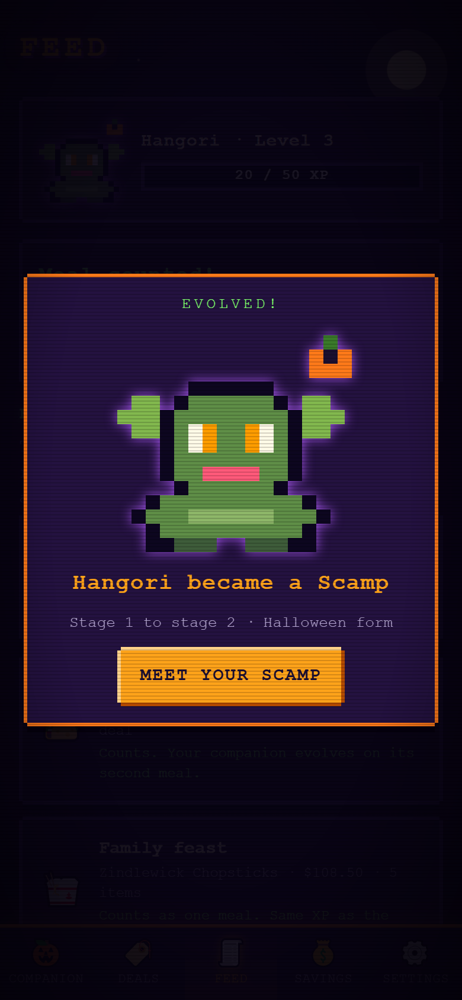
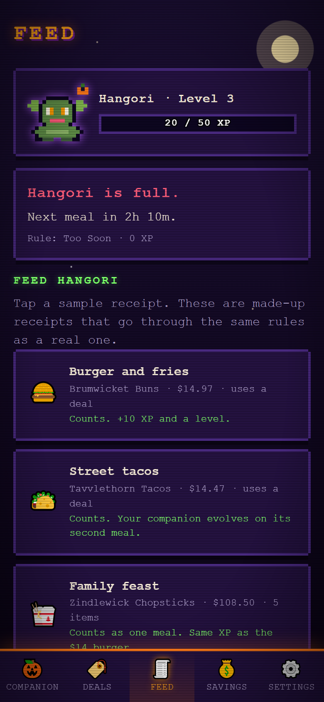
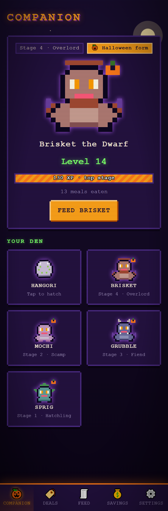
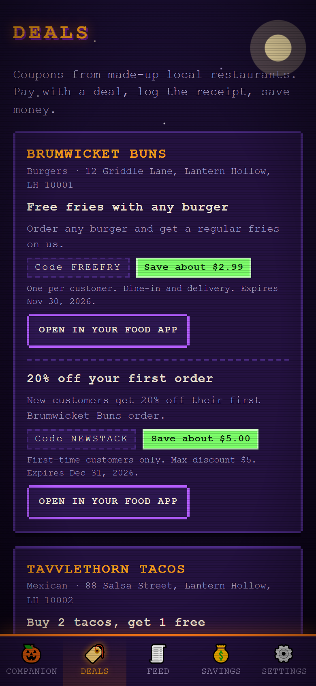
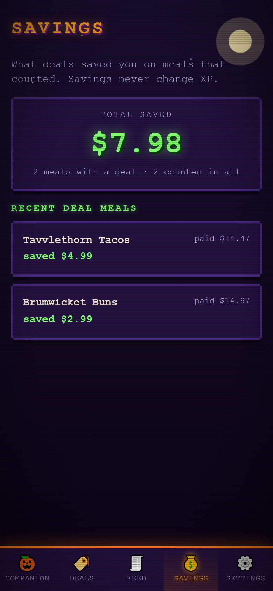
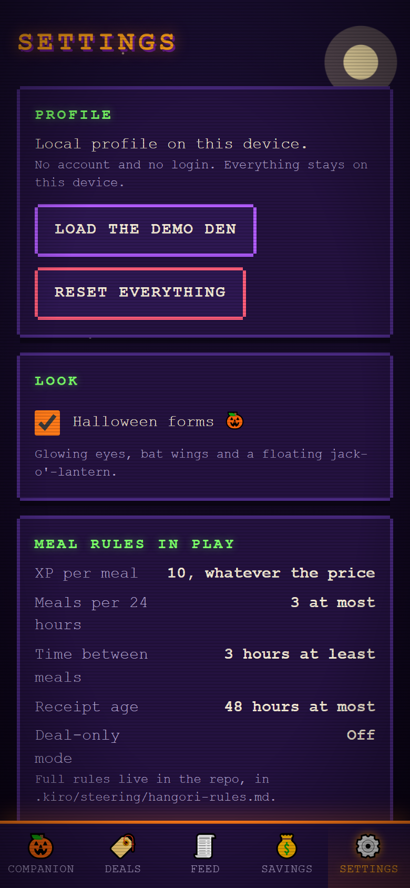

# Hangori

**Raise a spooky pixel creature by eating real meals, and save money doing it.**

Hangori collects restaurant coupons in one place. When you log a real meal with a receipt, your companion eats, gains XP, levels up and evolves. The goal is saving money on food. It is not about eating out more, so the app is built to resist gaming: a receipt counts once, a family feast counts as one meal, and a companion eats like one person.

Built for **Kiroween 2026**, category **Resurrection**: it revives the 90s virtual pet and the newspaper coupon clipper.

All data is synthetic. There is no account, no login and no backend. Everything runs on your device and works offline.

<table>
  <tr>
    <td></td>
    <td></td>
    <td></td>
  </tr>
  <tr>
    <td align="center">Pick an egg</td>
    <td align="center">Watch it hatch</td>
    <td align="center">Log a meal, level up</td>
  </tr>
  <tr>
    <td></td>
    <td></td>
    <td></td>
  </tr>
  <tr>
    <td align="center">Evolve</td>
    <td align="center">Try to game it</td>
    <td align="center">The demo den</td>
  </tr>
  <tr>
    <td></td>
    <td></td>
    <td></td>
  </tr>
  <tr>
    <td align="center">Deals</td>
    <td align="center">Savings</td>
    <td align="center">Settings</td>
  </tr>
</table>

## Try it in 60 seconds

The app is phone-first, so use a phone-sized window (or your browser's device mode).

1. **Pick a companion.** Tap Hangori's egg and watch it hatch.
2. **Feed it.** Tap **Feed Hangori**, then **Burger and fries**. The meal counts: **+10 XP** and a level-up.
3. **Evolve it.** Tap **Street tacos**. It is the second meal, so Hangori evolves into a Scamp, in its Halloween form.
4. **Try to cheat.** Tap **Same burger, photographed again** (rejected as already eaten), then **Another meal right away** (**Hangori is full. Next meal in 2h 10m.**). Tap **Family feast** for a $108.50 order: it counts as one meal, with the same 10 XP as the $14.97 burger.
5. **See the rest.** The other samples cover a hardware store, a three-day-old receipt, a future date, a receipt with no time and an unreadable one. Each shows its reason in plain words and awards no XP.

Want to see every stage at once? On the first screen tap **Load the demo den** (also in Settings). It loads one companion at each of the four stages and leaves Hangori's egg waiting, so you can run the steps above from there. **Reset everything** in Settings starts over.

A scripted version of this path runs in `e2e/demo-walk.spec.ts`. It takes about 5 seconds by machine, most of it the hatch animation.

## Set up

You need Node 20 or newer.

```
npm install
npx playwright install chromium   # only needed for the end-to-end tests
npm run dev                       # http://localhost:5173
```

| Command | What it does |
|---|---|
| `npm run dev` | Start the dev server |
| `npm run build` | Production build, with the service worker and manifest |
| `npm run preview` | Serve the production build |
| `npm run verify` | Lint, typecheck, unit and property tests |
| `npm run test:acceptance` | The meal-rule acceptance and property tests |
| `npm run e2e` | Playwright: every screen, plus the demo walk |

To install it as an app, serve the production build over `localhost` or HTTPS (`npm run build`, then `npm run preview`) and use your browser's install option. No hosting is set up in this repo.

To regenerate the screenshots in `docs/screenshots/`: set the environment variable `SCREENSHOTS=1` and run `npx playwright test e2e/screenshots.spec.ts`. Without it that spec is skipped, so a normal `npm run e2e` never rewrites tracked files.

## What is real and what is mocked

| Real | Mocked or not built |
|---|---|
| The meal rules: `evaluateMeal` passes all 58 acceptance tests, written before the code | Receipts: the Feed uses sample receipts built from synthetic fixtures. Camera capture and on-device reading are not wired in. The reading spike passed (17 of 20 receipts, `docs/spikes/receipt-extraction.md`), so it is next |
| The ledger: IndexedDB, serialised submits, a unique index on the receipt fingerprint, and the meal and its XP saved in one transaction | Deals: `fixtures/deals.json` behind a `DealsAdapter` interface. Link-outs open a placeholder page |
| Companion levels, evolution stages and Halloween forms | The "demo account": a seeded local profile, not a login. No credentials exist anywhere |
| Offline use: checked against a production build with the network off (all five screens, all 16 deals, and a counted meal) | Art: original pixel art drawn in code, placeholder quality. The app icons are still plain placeholder squares |

The rules themselves live in one place, `.kiro/steering/hangori-rules.md`, and this README does not repeat them.

## How the build used specs, steering and hooks

This project was built with Kiro, and the Kiro files are part of the repo.

**Steering** (`.kiro/steering/`) is what the agent reads on every run. `hangori-rules.md` holds the product rules that never bend: one meal per receipt, no XP from price, no gaming, no brand names in the UI. `product.md`, `tech.md` and `structure.md` hold the product, the stack and the folder layout, and `working-style.md` holds the working rules (one command at a time, ask before adding a package or changing a contract). `AGENTS.md` at the root applies the same boundaries to any coding agent. The rules did real work: the "no third-party brand names" rule became an end-to-end check, and the "XP never depends on price" rule became a property test.

**Specs** (`.kiro/specs/`) turn a goal into requirements, a design and tasks.
- `foundation` produced the PWA shell, the shared contracts and the synthetic fixtures.
- `demo-ready` (requirements in EARS form, a design with correctness properties, and tasks in waves) produced everything in this README. Each wave ended with lint and tests, then a commit that names the steering and spec files it used.
- The meal rules were built **test first**. The acceptance and property tests were committed in a separate session before any implementation existed (`tests/acceptance/`), and the implementation then passed all 58 unchanged. The tests were never edited to make them pass.

**Hooks** (`.kiro/hooks/`) are automatic guard rails:

| Hook | When it runs | What it does |
|---|---|---|
| `guard-contracts` | Before the agent writes a file | Blocks edits to `src/contracts/`, which change only through an approved request |
| `guard-dependencies` | Before the agent writes a file | Blocks edits to `package.json`, so packages stay on the approved list in `docs/speed.yml` |
| `meal-rules-tests` | After a file in `src/domain/meals/` or `tests/acceptance/` is saved | Runs the acceptance suite |
| `verify-after-task` | After a spec task finishes | Runs `npm run verify` |
| `demo-walk` | When you trigger it | Runs `e2e/demo-walk.spec.ts` |

`docs/kiro-journal.md` logs each run, and `docs/session-log/` holds the notes behind them.

## Project layout

```
src/contracts/        Shared Zod schemas and types (change only through a change request)
src/domain/meals/     The meal rules and the ledger (no React)
src/domain/companions/ Levels, stages and the roster (no React)
src/app/              Profile state, the deals adapter, the demo seed and sample receipts
src/features/         One folder per screen: companion, deals, feed, savings, settings
src/ui/               Pixel sprites, XP bar, evolution overlay, navigation, theme
fixtures/             Synthetic restaurants, deals and receipts
tests/acceptance/     Test-first meal-rule tests
e2e/                  Playwright: smoke tests, the demo walk, the screenshot generator
.kiro/                Steering, specs and hooks
```

## Known limits

- `npm run verify` runs unit and property tests but not the acceptance suite, because that suite was red while it waited for the code. It is green now, so the `test` script in `package.json` can drop its `--exclude tests/acceptance/**` flag. Until then, run `npm run test:acceptance` as well.
- `fixtures/deals.json` stores `expiresAtMs` values that do not match the dates in each deal's terms text. The app shows the terms text and ignores `expiresAtMs`.
- Sample receipt times hang off a stored start time, and refresh after 12 hours. That keeps a repeated tap a true duplicate across a reload, and keeps the samples inside the 48-hour window.
- Several dev-tool packages carry audit findings that have no non-breaking fix. They are listed with a review date in `docs/speed.yml`.

## License

See `LICENSE`.
